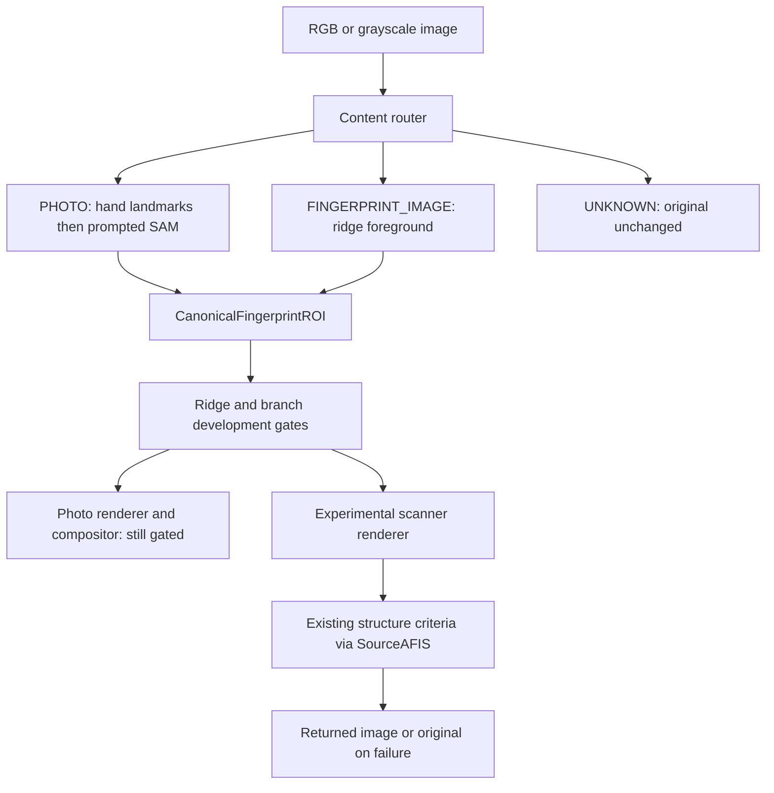

# Unified PHOTO and scanner fingerprint front-end

The entrypoint is `scripts/protect_fingerprint.py`, shared by Linux and Windows at the Python/core layer. Platform-specific matcher adapters remain separate. New PHOTO model inference and new Windows runtime paths are not validated yet.



## Contract

CanonicalFingerprintROI contains source SHA-256/type, native bbox, full-image uint8 0/255 mask, centered aspect-preserving 512 grayscale normalization, ridge quality, orientation, native pitch, confidence, rejection reason and implementation version. Arrays and masks are private. Validation checks hash, dimensions, values, bbox containment and pitch. Result JSON stores relative mask/normalized paths, file/pixel hashes, source dimensions and EXIF orientation. Output PNG retains the orientation tag; masks remain encoded-native coordinates.

Routing uses actual color/chroma, periodic ridge evidence, exposure-relative border simplicity and foreground occupancy. No filename/person rule exists. Ambiguity returns UNKNOWN. RGB is not automatically a fingerprint target. A grayscale scanner representation may be routed even when stored in RGB channels. This router is an experimental classifier, not general input-type accuracy validation.

## PHOTO

The primary adapter uses MediaPipe 21 hand landmarks, TIP/DIP/PIP (thumb IP/MCP) anatomy to construct SAM boxes, positive distal points and neighboring/palm negatives. SAM Predictor processes each prompt. The anatomical search is restricted, but ratio crops alone never authorize a pad: the learned DIP/IP distal plane, image-observed ridge tiles, coherence, frequency and association with the landmark are required. Crease is optional. Legacy code remains diagnostic fallback after landmark failure; it is never silently promoted.

COLFISPOOF is not vendored. Its code and licensing must be verified before integration; README citation instructions alone were not treated as a redistribution license. MediaPipe source is Apache-2.0; task-model distribution/version/hash should be reviewed/pinned separately. Configure these in an isolated environment with compatible mediapipe, torch and official segment-anything. Do not alter the existing validated environment. No installation/model download was completed here because network DNS fails.

```sh
python ai/scripts/protect_fingerprint.py --input /path/to/private/photo.jpg --output /path/to/private/new-result
# After dependencies and model provenance are verified:
python ai/scripts/protect_fingerprint.py --input /path/to/private/photo.jpg --hand-model /path/to/hand_landmarker.task --sam-checkpoint /path/to/sam_vit_b.pth --output /path/to/private/new-result
```

Even configured photo detections remain review-only until actual GT7 approval and frozen renderer binding are validated. PHOTO transformation is intentionally not enabled by a CLI override. Lack of runtime is reported as blocked, not success.

## Scanner

Scanner detection never uses MediaPipe/SAM. Grayscale periodicity, local coherence/frequency/contrast and connected foreground generate the canonical ROI. Larger inputs use multi-resolution evidence; the current implementation returns the dominant contiguous scanner foreground, not an assurance of complete multi-finger/card segmentation.

```sh
python ai/scripts/protect_fingerprint.py --input /path/to/private/fingerprint.png --output /path/to/private/new-result
# Linux: configure the existing separately verified runtimes for extraction/structure:
BLURFING_SOURCEAFIS_HOME=/path/to/sourceafis python ai/scripts/protect_fingerprint.py --input /path/to/private/fingerprint.png --output /path/to/private/new-result
```

Experimental scanner output uses a shared independent topology/field generator with scanner-style grayscale intensity mapping and mask taper. natural_auto_04/boundaryblend_02 are preserved and not forced onto scanner images. Without a valid structure guard, or on guard failure, output is original. Strength 0 changes no pixels. This is development-only behavior, not a default privacy guarantee.

NBIS optional matching uses the existing hash-pinned runtime JSON via BLURFING_NBIS_LINUX_CONFIG. SourceAFIS uses the existing platform facade and hash-checked JAR setup. Thresholds/settings are unchanged. Do not interpret extraction failure as protection success.

## Public-source smoke

```sh
python -m pip install -r ai/requirements.txt
python -m unittest discover -s ai/scripts -p 'test_unified_fingerprint_frontend.py'
python -m unittest discover -s ai/scripts -p 'test*.py'
```

Smoke tests use generated arrays, no biometric fixtures. Actual optional model/runtime validation requires separately supplied files. See [Linux validation](../results/unified_frontend_validation.md) for measured capabilities, blocked photo evaluation and limitations. Current final-independent-validation and project-complete flags remain false.

The CLI attempts the approved development scanner path by default, with the built-in unchanged-criteria structure guard. Missing runtimes return the original. `--detect-only` disables transformation; the old `--experimental-scanner-transform` flag remains a compatibility alias. Programmatic callers supply an explicit guard when enabling scanner rendering. PHOTO is still gated and cannot be enabled by a scanner flag.

Near-full-frame scanner masks are allowed when at least half of analysis windows carry credible ridge evidence; this case is tested on generated arrays and does not imply accuracy on arbitrary periodic textures.

Orientation metadata currently uses the gradient-normal angle in radians; ridge tangent is perpendicular modulo pi. The renderer does not copy this observed orientation field. Supported public image ingestion is 8-bit RGB/L through Pillow; WSQ fixtures were explicitly decoded by official dwsq before API ingestion. Raw WSQ and higher-bit-depth input support are not claimed.
