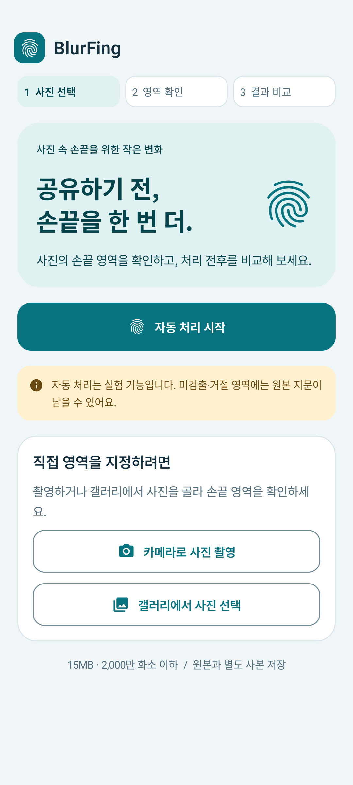
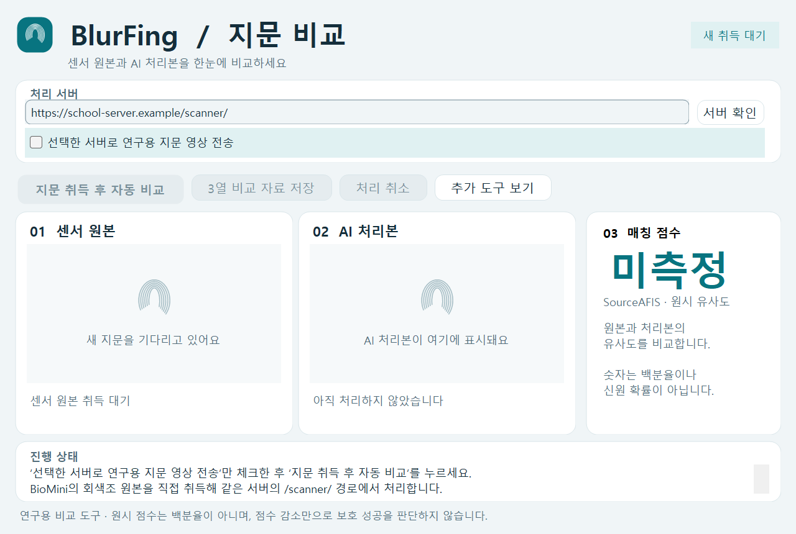

# Android·Windows 화면 디자인 개선 — 2026-10-21

실제 BioMini 취득을 먼저 복구한 후, 사용자가 확인한 0.2.4 원클릭 자동 비교 3회 성공을 기준으로 기존 Android·EXE 디자인 요청을 이어서 수행했다. 기능 구현 소스는 `38e0be8`이다.

## 변경 결과

- Android **1.0.5 / versionCode 6**. 밝은 회색 배경, 청록색 기본 동작, 흰 카드, 공통 글자·여백·모서리 규칙을 적용했다. 어두운 테마도 대응 색상을 정의했다.
- 홈에서 자동 처리 시작을 우선 배치하고, 직접 영역 지정의 카메라·갤러리는 별도 카드로 묶었다. 사진 선택→영역 확인→결과 비교 단계를 표시한다.
- 자동 사진 처리 화면의 서버·엔진 설정을 접고 펼칠 수 있도록 했다. 현재 엔진, 업로드 안내, 부분 적용·거절 표시는 유지한다. 사진 선택·취소·저장·공유 상태 조건은 유지했다.
- Windows **0.3.0**. 원본·AI 처리본·SourceAFIS 원시 점수를 세 카드에 나란히 배치했다. 새 취득, 서버 처리, 비교 완료 상태를 상단에 표시한다. 취득·저장·취소는 기본 화면, DPI·수동 입력·취득기 설정은 추가 도구로 묶었다.
- Windows 추가 도구를 펼칠 때 넓이 초과로 오른쪽이 잘리던 배치를 수정했다. 짧은 이미지 영역의 빈 상태는 아이콘만 표시하고, 점수 상세는 스크롤할 수 있다. 버튼의 키보드 포커스 표시를 유지한다.

검증된 BioMini raw helper, 입력 픽셀 검증, 서버 API·AI 모델, 취소·요청 일치 검사, 출력 저장 형식은 이번 디자인 변경에서 수정하지 않았다. 서버 측 설치나 설정 변경도 없다.

## 검증 범위

- Android debug/release 단위 검사: 각각 **240 통과, 선택 검사 1 건너뜀, 실패 0**.
- API 37 에뮬레이터 UI 검사 **20/20 통과**. 사진 가져오기·영역 편집·비교·갤러리 저장·뒤로가기·자동 처리 진입·실험 결과·다른 사진 교체·이탈 흐름을 검사했다. 공개 합성 픽셀과 제어된 응답을 사용했으며 실제 AI 성능 검사가 아니다.
- UI 렌더 파일 확보를 위해 해당 흐름 6개를 별도 instrumentation 실행으로 반복하여 **6/6 통과**했다. Gradle의 설치 정리 후 파일이 남지 않아, 직접 실행한 테스트 앱의 전용 폴더에서 합성 렌더만 가져왔다.
- Windows 계약 검사 **30/30 통과**. 기존 실제 Framework helper 프로세스/pipe, 취소, 회색조 샘플, 요청·해시 검증, 점수·저장 검사를 포함한다. 센서 없이 실행하는 부분은 합성 계약 검사다.
- Windows 자체 포함 x64 EXE가 별도 .NET 설치 없이 자체 화면 렌더 명령을 종료 코드 0으로 완료했다. 기본 화면·최소 크기·추가 도구 화면을 확인했다. 앱 자체 control tree를 렌더하며 사용자 데스크톱이나 지문 화면을 촬영하지 않는다.
- 이전 0.2.4의 실물 센서·실제 학교 서버 자동 비교 3회 성공은 사용자 확인 기록이다. 디자인 버전 0.3.0의 새 실물 반복 확인, 1.0.5의 실물 휴대폰 확인은 별도로 수행하지 않았다. 이전 실물 성공을 새 버전의 재검증으로 계산하지 않는다.

위 화면은 빈 상태 또는 합성 UI 렌더이며 실제 지문이나 AI 결과가 아니다. Windows 예시 주소는 실제 연결 설정을 덮어쓰지 않는다.

## 배포·보존

- 바탕화면 `BlurFing_디자인개선_20261021`에 Android AAB·개발 APK, Windows EXE, 화면 미리보기, 해시·검증 기록을 제공한다. 기존 0.2.4 전달본과 사용자가 열어둔 결과는 보존한다.
- Windows는 기존 개인 서버·취득기 설정을 사용한다. 새 프로그램을 사용하기 전에 기존 창의 필요한 결과를 저장하고 닫으면 된다.
- Android는 기존 업로드 키로 서명하고 기존 Play 내부 테스트 트랙을 업데이트한다. 개발 APK는 Play 설치본과 서명이 다르므로 스토어 업데이트를 안내한다.
- 기존 5개 data 파일의 미커밋 변경은 해시로 보존하고 커밋 대상에서 제외했다. 지문 원본·SDK 바이너리·서명키·비밀번호는 공개 저장소에 추가하지 않았다.

## 최종 배포 확인

- 기존 업로드 인증서 일치·AAB 서명·ZIP CRC·bundletool 1.18.3 구조 검사가 통과했다. 매니페스트는 `com.blurfing.app`, 1.0.5(6), minSdk 26 / targetSdk 36이다. 포함된 arm64·x86_64 네이티브 라이브러리의 ELF load segment 16KiB 정렬을 확인했다.
- 최종 release lint: 오류 0, 경고 38, 힌트 2. Play의 난독화 매핑·네이티브 디버그 기호 미첨부 경고 2개는 별도이며 게시 차단 오류는 없었다. R8 난독화는 기존과 같이 비활성이다.
- **2026-10-21 20:00 KST**, 기존 내부 테스트 트랙에서 `1.0.5-design-internal-20261021`이 **내부 테스터에게 제공됨**으로 표시되는 것을 확인했다. 정식 프로덕션 출시는 아니다. 기기 반영에는 시간이 걸릴 수 있다. [기존 내부 테스트 설치 링크](https://play.google.com/apps/internaltest/4701465252756119179)를 사용한다.
- 게시 증빙 화면은 개인 바탕화면 전달 폴더에만 보관했다. 바탕화면 **BlurFing 센서 (최신)** 바로가기는 0.3.0 EXE를 가리킨다. 이전 사용자 창을 종료하거나 그 결과를 지우지 않았다.
